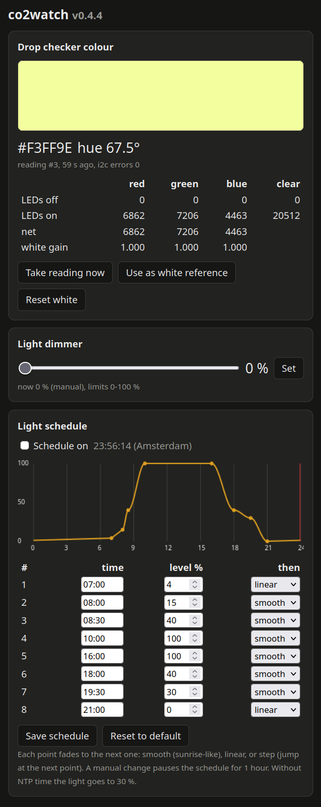
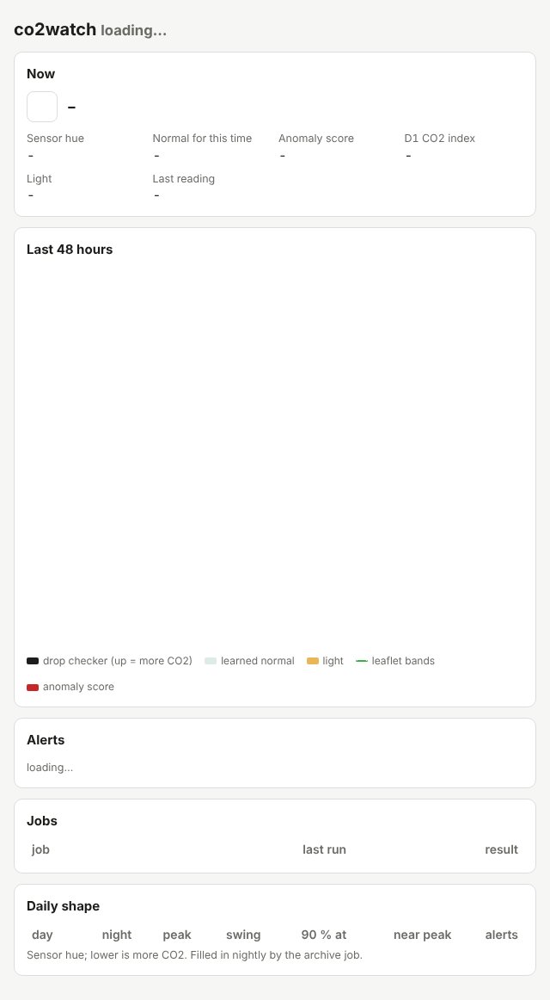

# co2_rgbsensor_reading (co2watch)

Reading a CO2 drop checker with an RGB sensor and analysing the data with ML.

Self-learning anomaly detection for an aquarium CO2 drop checker, read by a
TCS34725 colour sensor on a Wemos D1 mini. The D1 serves `/metrics`,
VictoriaMetrics scrapes it, and this Python package learns what normal looks
like, logs alerts with plain reasons and learns from your labels. Logging only;
it never controls equipment.

**Status: M0** (design, simulator, self-calibration, data access). Nothing has
been tested on real tank data yet. See [docs/design.md](docs/design.md) for the
decisions, roadmap and open items.

## The D1 web page

The D1 mini serves a small page (`http://co2watch.fritz.box/`) with the drop-checker colour, the light dimmer and the light schedule:



## Status page

`co2watch serve` is a small read-only page for the pipeline itself, served
from the cluster (no Grafana needed): the estimated CO2 now, the last 48 h
against the learned normal band, alerts with their reasons, the last run of
each job, and the daily shape from the archive.



```bash
co2watch serve --db data/labels.sqlite --vm http://<vm-host>:8428 --port 8080
co2watch serve --db data/labels.sqlite --csv data/sim/sim_readings.csv   # local mock
```

On k3s the chart runs it as `co2watch-web` on NodePort 30880 (see
[docs/deploy.md](docs/deploy.md)).

## What's here

| Path | What |
|---|---|
| `firmware/` | D1 mini sketch: two-frame sensor readings, `/metrics`, light dimmer and schedule, web page, OTA, local page emulator (see `firmware/README.md`) |
| `docs/design.md` | decisions, architecture, `/metrics` contract, roadmap, open items |
| `docs/detection.md` | M2 detectors, how alerts are scored and explained, evaluation on simulated data |
| `docs/deploy.md` | Helm install on k3s, labelling via the toolbox pod, backups, troubleshooting |
| `deploy/helm/co2watch/` | Helm chart: namespace, SQLite PVC, toolbox pod, status page, CronJobs |
| `Dockerfile`, `.github/workflows/image.yml` | multi-arch image (amd64 + arm64) pushed to GHCR on a version tag |
| `src/co2watch/vm.py` | read raw frames + context from VictoriaMetrics; CSV export; backfill import |
| `src/co2watch/db.py` | SQLite: labels, calibration events, alert log, job runs, model registry |
| `src/co2watch/features.py` | LED off/on frame subtraction, hue, ratios, UTC grid, rolling features, local time |
| `src/co2watch/simulator.py` | synthetic tank + drop checker + two-frame sensor, with injectable anomalies |
| `src/co2watch/archive.py` | long-term store in SQLite: hourly/daily aggregates, raw windows around alerts and labels |
| `src/co2watch/web.py`, `static/status.html` | status page (`co2watch serve`): stdlib HTTP server, one JSON endpoint, plain HTML/JS |
| `src/co2watch/detect.py`, `evaluate.py` | M2 detection and its evaluation on simulated anomalies |
| `src/co2watch/calibration.py` | self-calibration against the leaflet chart, drift report |
| `src/co2watch/config.py` | leaflet chart (KH4), metric names, priors |
| `tests/` | unit tests (`pytest`), including a fake VM for the import/export round trip |

## Quick start

```bash
python -m venv .venv && . .venv/bin/activate
pip install -e ".[dev]"
pytest

# 6 weeks of synthetic data (CSV), with the standard anomaly set
co2watch simulate --days 42 --out data/sim --db data/labels.sqlite
co2watch calibrate --csv data/sim/sim_readings.csv --db data/labels.sqlite

# same, but through VictoriaMetrics (written with source="sim", kept apart
# from the scraped series)
co2watch simulate --days 42 --out data/sim --vm http://<vm-host>:8428
co2watch calibrate --vm http://<vm-host>:8428 --source sim --days 42

# real data once M1 is scraping
co2watch calibrate --vm http://<vm-host>:8428 --db data/labels.sqlite
co2watch export-csv out.csv --vm http://<vm-host>:8428 --days 30
```

## Labelling (CLI)

```bash
co2watch label normal       --db data/labels.sqlite --start "2026-11-24 14:00" --end "2026-11-24 16:00"
co2watch label real_problem --db data/labels.sqlite --start ... --end ... --note "regulator empty"
co2watch label sensor_issue --db data/labels.sqlite --start ... --end ...
co2watch label eye_check    --db data/labels.sqlite --start "2026-11-24 18:00" --end "2026-11-24 18:15" --band green
co2watch mark-calibration   --db data/labels.sqlite --kind fluid_change --when "2026-11-24 10:00"
```

Times are Europe/Amsterdam local unless they carry an offset.

## Simulated anomalies

`stuck`, `dropout`, `jump`, `case_slipped`, `light_leak` (sensor/setup),
`missed_co2`, `overdose`, `solenoid_stuck_open`, `diffuser_decline` (real
problems), and `fluid_change` (a calibration event, not an anomaly). Each comes
with a labelled time window in `sim_labels.csv`.
