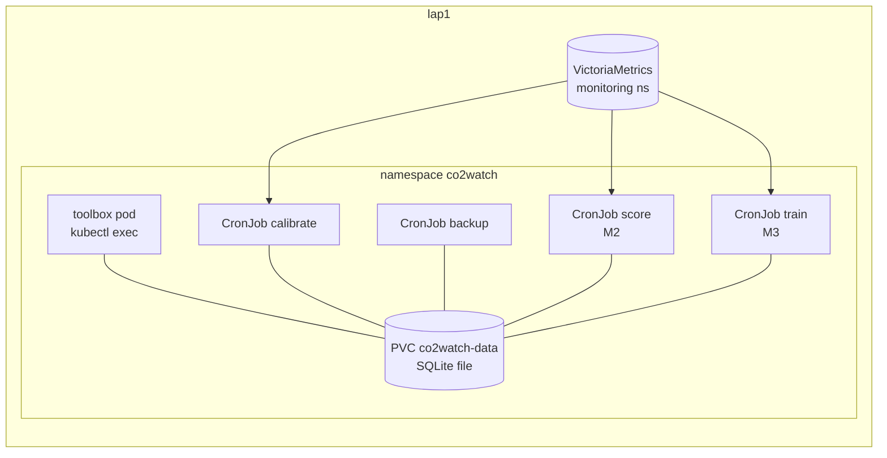

# Deploying co2watch on k3s (Helm)

Chart: `deploy/helm/co2watch`. Nothing is installed automatically; the steps
below are for when you decide to.

## What the chart creates

| Resource | Name | Purpose |
|---|---|---|
| Namespace | `co2watch` | own namespace, Pod Security `restricted`; kept on uninstall |
| PersistentVolumeClaim | `co2watch-data` | RWO volume holding `/data/co2watch.sqlite` and `/data/backups/`; kept on uninstall |
| ConfigMap | `co2watch-env` | VM URL, DB path, time zone |
| Deployment | `co2watch-toolbox` | 1 pod that holds the volume; creates the schema on start (init container); use it for labels, calibration events and `sqlite3` |
| CronJob | `co2watch-calibrate` | daily 10:30 local: anchors + fit from the last 21 days, saved to SQLite |
| CronJob | `co2watch-backup` | daily 03:45 local: consistent SQLite copy, keeps 14 |
| CronJob | `co2watch-score` | every 5 min (M2), **off** until `co2watch score` exists |
| CronJob | `co2watch-train` | weekly Monday 04:00 (M3/M4), **off** until `co2watch train` exists |



## Why there is no "SQLite server"

SQLite is a file, not a service. Every pod that needs it mounts the same
ReadWriteOnce volume, and all of them are pinned to lap1 (`nodeSelector`), which
is also where a `local-path` volume physically lives. Writers are kept safe by:

* SQLite's file locking on a real local filesystem (with a 30 s busy timeout),
* `concurrencyPolicy: Forbid` on every CronJob, so a job never overlaps itself,
* `strategy: Recreate` on the toolbox, so a rollout never runs two copies.

Never put the file on NFS/SMB or a ReadWriteMany volume (Longhorn RWX is NFS):
SQLite's locks don't work there and the database can corrupt. Longhorn **RWO**
is fine if you prefer replicated storage (`storage.storageClassName: longhorn`).

## 1. Build the image

The image must exist for amd64 (lap1) and arm64 (pi1/RK1). Either:

* push a tag (`git tag v0.2.0 && git push origin v0.2.0`); `.github/workflows/image.yml`
  runs the tests and pushes `ghcr.io/justleen/co2watch:0.2.0`, or
* build locally: `docker buildx build --platform linux/amd64,linux/arm64 -t ghcr.io/justleen/co2watch:0.2.0 --push .`

GHCR packages start **private**. Either make the package public, or create a
pull secret in the namespace and set `imagePullSecrets`.

## 2. Install

```bash
helm install co2watch deploy/helm/co2watch -n default
```

* The defaults in `values.yaml` are set for the homelab cluster: VM at
  `http://victoriametrics.monitoring.svc.cluster.local:8428`, everything pinned
  to the node `lap1.fritz.box` (the hostname label includes the domain), volume
  on `local-path`. Override with `--set vm.url=...` for another cluster.
* The release record lives in `default`; the resources go to `co2watch`. Do not
  add `--create-namespace` (the chart creates the namespace itself). If you
  prefer `-n co2watch --create-namespace`, set `namespace.create=false`.
* Check: `kubectl -n co2watch get pods,cronjobs,pvc`.

## 3. Use

```bash
NS=co2watch; DB=/data/co2watch.sqlite
kubectl -n $NS exec deploy/co2watch-toolbox -- co2watch label normal --db $DB --start "2026-11-24 14:00" --end "2026-11-24 16:00"
kubectl -n $NS exec deploy/co2watch-toolbox -- co2watch label eye_check --band green --db $DB --start "2026-11-24 18:00" --end "2026-11-24 18:15"
kubectl -n $NS exec deploy/co2watch-toolbox -- co2watch mark-calibration --db $DB --kind fluid_change
kubectl -n $NS exec -it deploy/co2watch-toolbox -- sqlite3 $DB 'select * from labels'
kubectl -n $NS create job --from=cronjob/co2watch-calibrate calibrate-now && kubectl -n $NS logs -f job/calibrate-now
```

## 4. Backups

The backup CronJob copies the database to `/data/backups` **on the same
volume**. That protects against a bad write or a bad model run, not against
losing lap1's disk. For off-node copies, pick the same route as the open VM
backup decision (Longhorn backup, or a copy to the pi1 backup volume); copying
`co2watch-*.sqlite` files is safe because they are complete snapshots.

## 5. Upgrade / uninstall

* `helm upgrade co2watch deploy/helm/co2watch -n default --reuse-values --set image.tag=0.3.0`
* `helm uninstall co2watch -n default` removes the pods and CronJobs but
  **keeps** the namespace and the PVC with your labels. Delete them by hand only
  if you really want the data gone.

## Troubleshooting

| Symptom | Likely cause |
|---|---|
| Pods `Pending`, "didn't match node selector" | the hostname label doesn't match `nodeSelector` (here it is `lap1.fritz.box`): check `kubectl get nodes --show-labels` |
| Pods `Pending`, taint | lap1 as control plane may be tainted; add a matching `tolerations` entry |
| `ImagePullBackOff` | image not built for this arch, or GHCR package private without a pull secret |
| `unable to open database file` / permission denied | volume directory not writable by uid 10001; k3s local-path creates it world-writable, other provisioners may not (fix with an init step or a different storage class) |
| `database is locked` after 30 s | a long job holds the write lock; check overlapping manual jobs |
| calibrate job fails with connection refused | `vm.url` wrong; test from the toolbox: `python -c "import urllib.request;print(urllib.request.urlopen('$VM_URL/health').read())"` |
| CronJob ignores time zone | k3s older than 1.27; upgrade, or write schedules in UTC |
