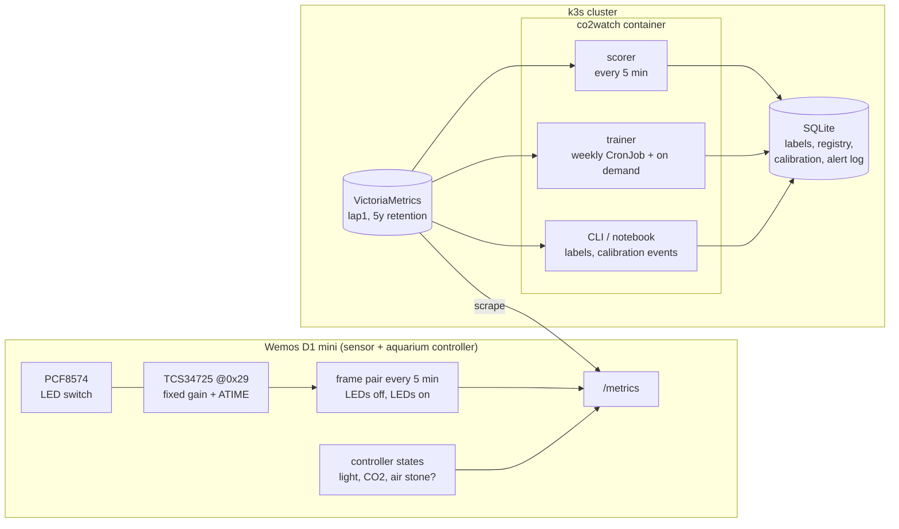

# co2watch design (v0.2)

Self-learning anomaly detection for a CO2 drop checker read by a TCS34725 colour
sensor. This document records the architecture, the decisions made, the options
considered and every assumption. Nothing here has been validated on the real
tank yet. Numbers come from the simulator or from the leaflet.

**v0.2 changes** (decisions from 2026-11-21 to 11-23): no LLM, no Home
Assistant, no notifications for now. Raw data goes to VictoriaMetrics (scraped
from the D1's `/metrics`); SQLite holds only labels, the model registry,
calibration events and the alert log. Each reading is two frames (LEDs off and
on, LEDs switched through a PCF8574).

## 1. Decisions

| Topic | Decision |
|---|---|
| Detection | Classical ML only: hard-fault rules, a per-time-of-day robust baseline, then Isolation Forest. A forecaster is only tried if those miss cases. |
| LLM | Not in the plan. Alerts carry templated reasons written by the detectors. |
| Raw data store | VictoriaMetrics (VM) on the k3s cluster, pinned to lap1, retention 5 years. |
| Other storage | SQLite: labels, model registry, calibration events, alert log, cached daily anchors. |
| Ingest | The D1 mini serves `/metrics`; VM scrapes it. No Home Assistant, no Influx, no push. The sensor and the aquarium controller share one D1. |
| Notifications | None for now. Alerts are logged; labelling is done with the CLI or the notebook. |
| Illumination | The breakout's two LEDs are switched through a PCF8574 I2C expander. |
| Readings | Two frames per reading, LEDs off then on. Signal = on - off (ambient subtracted); the off frame is the ambient/leak level. |

## 2. Architecture

* The D1 only reads and publishes. All logic runs in Python in a container.
* Scraping means the ML side can be down without losing data. If the D1 or Wi-Fi
  is down, the gap stays a gap.
* Fully offline.

## 3. Roadmap

This repo's steps, aligned with the M-numbering in your local `plan.md` as far
as known (only M1 was in the summary; please correct the rest, or commit
`plan.md` to this repo so there is one source).

| Milestone | Contents | Where | Status |
|---|---|---|---|
| M0 | Design, simulator, self-calibration, VM/CSV access, label store | this repo | done (this PR + #1) |
| M1 | D1 firmware with `/metrics` and two-frame readings via PCF8574; VM scrape job; measure gain and integration time on the real tank | firmware / k3s repos | next |
| M2 | Hard-fault rules + per-time-of-day baseline + daily summaries; templated reasons; alert log; evaluation notebook on simulated data | this repo | |
| M3 | Isolation Forest on window features, compared against M2 on simulated and labelled events | this repo | |
| M4 | Labelling CLI/notebook flow, weekly retraining, model registry and rollback, active-learning list | this repo | |
| M5 | Container image + Helm chart: namespace, SQLite PVC, toolbox, CronJobs (see `docs/deploy.md`) | this repo | chart written; score/train jobs switched off until M2-M4 |
| M6 | Evaluate on 2+ weeks of real data, tune thresholds; decide on notifications | this repo | |

## 4. The `/metrics` contract (needed for M1)

The names below are what this code expects. They are set in
`src/co2watch/config.py` and are assumptions until the firmware exists.

| Metric | Labels | Meaning |
|---|---|---|
| `tcs34725_raw` | `channel`=red/green/blue/clear, `led`=off/on | raw counts of the last frame pair |
| `tcs34725_reading_timestamp_seconds` | | when the last frame pair was taken (lets VM's scrape interval differ from the reading interval) |
| `tcs34725_reading_seq` | | increments every reading; a stuck counter means stuck firmware, frozen counts with a moving counter means a stuck sensor |
| `tcs34725_atime`, `tcs34725_gain` | | must stay fixed; a change invalidates the baseline and is flagged |
| `tcs34725_i2c_errors_total` | | I2C failures (dropout rule) |
| `aquarium_light_on`, `aquarium_co2_on`, `aquarium_airstone_on` | | 0/1, only if the controller knows the real states (open item) |
| `aquarium_temperature_celsius`, `aquarium_ph` | | only if those sensors are added (open item) |

Firmware notes from the datasheet: I2C address 0x29 at 3.3 V; saturation at
`(256 - ATIME) * 1024`, capped at 65535 (readings at the limit are masked,
because the subtraction is then wrong); take the off frame and the on frame
back to back so ambient changes little in between; wait one full integration
time after switching the LEDs.

## 5. Storage

**VictoriaMetrics (raw data).** Scraped series have no `source` label. Anything
imported (simulated data, CSV backfill) must carry one (`source="sim"`,
`source="backfill"`), and the code refuses to import without it. Readers select
`source=""` (scraped) by default, so test data can never leak into training.

**SQLite (`src/co2watch/db.py`).**

| Table | What |
|---|---|
| `labels` | normal / real_problem / sensor_issue / ignore / eye_check (with band), time window, feature snapshot |
| `calibration_events` | fluid replaced, sensor moved: starts a fresh baseline |
| `anchors` | daily night low and daytime plateau (derived cache) |
| `alerts` | alert log with score, detector, templated reason |
| `models` | every trained model, params, metrics, active flag (rollback = switch the flag) |

**CSV.** `export-csv` writes VM data (both frames + context, UTC and local time);
`backfill` imports such a CSV into VM under a source label.

## 6. Time handling

* Processed in UTC. A regular 5-minute UTC grid is built when reading; missing
  slots are kept as `missing=True` rows, never interpolated.
* Schedule-related features (hour of day, night, time since CO2 on) use
  Europe/Amsterdam local time. The DST-end day has 25 hours and the DST-start
  day 23; tests cover this.
* "Time since CO2 on" comes from the controller state when it is reported,
  otherwise from the learned daily pattern.

## 7. Features (`features.py`)

* From the two frames: net channels `on - off`, `ambient_clear` (off-frame
  clear), `ambient_frac`, saturation mask.
* Per reading: hue (from the net r, g, b), saturation, r/c, g/c, b/c, local hour.
* Windowed (30 min): rolling median hue, std, slope (deg/hour), net clear
  relative to its 7-day median, ambient level, number of raw value changes
  (0 = flat-line).
* Hue goes **down** as CO2 goes up (blue ~200+, green ~115, lime ~65 degrees on
  the leaflet; the sensor's numbers differ, see section 8).

What the two frames buy (shown on simulated data, to be confirmed on the tank):
tank light and sunlight no longer move the hue; a light leak or a moved sensor
shows up in `ambient_clear` instead of being mixed into the colour; night
readings are valid because the LEDs light the checker.

Not removable by subtraction: PWM flicker of the tank light between the two
frames (simulated as 2 % noise) and the glass optics. Both need measuring on the
tank (M1).

## 8. Self-calibration (`calibration.py`)

Goal: say roughly which leaflet band a reading is in, without a test kit.

**Leaflet (KH4 column)**, hues sampled from the leaflet picture:

| Band | pH | CO2 mg/l | chart hue |
|---|---|---|---|
| blue | 7.6 | 3 | 203 |
| blue-green | 7.2 | 8 | 186 |
| teal-green | 7.0 | 12 | 167 |
| green (target) | 6.8 | 20 | 115 |
| lime (too high) | 6.4 | 50 | 64 |

These match CO2 = 3 x KH x 10^(7 - pH) (checked in tests).

**Model:** `chart_hue = a + b * sensor_hue`, fitted with a Bayesian prior.

* **Night anchor (automatic, daily):** the most stable, bluest 60-minute window
  before the CO2 turns on is assumed to be the 3 mg/l band. This fixes `a`.
  Without controller states, 03:00-08:00 local is used.
* **Scale `b`:** stays at the prior 1.0 +/- 0.35 without other information, so
  estimates far from the night anchor are uncertain. Simulated: a true 21 mg/l
  peak is reported as "about 34 mg/l, plausible 19-61".
* **Eye checks (optional):** `co2watch label eye_check --band green --start ...
  --end ...`. Each one is an anchor with about one band of uncertainty. One
  "green" at the daily peak narrows the simulated estimate to 19-26 mg/l.
* **The daytime plateau is measured, not assumed.** It is the tank's normal
  daily peak and the main reference for the detectors.
* **Calibration events** (`co2watch mark-calibration`): only anchors after the
  event are used; the fit reports `settling` until 3 nights have been seen.
* **Drift report:** robust (Theil-Sen) slopes of night low, plateau and daily
  swing over 14 days. Whole scale moving with a constant swing is consistent
  with fluid ageing and is followed; a shrinking swing points at injection
  (diffuser, bubble counter, regulator) and is flagged in M2.

Chart-based absolute limits ("lime = overdose") are used only when the fit is
`ok` and has eye checks. Until then, overdose is relative to the learned plateau.

## 9. Detection (M2-M3), options considered

| Option | Pros | Cons | Verdict |
|---|---|---|---|
| Hard-fault rules: flat-line (raw frames + `reading_seq`), NaN, saturation, dropout/I2C errors, ATIME/gain changed, net-clear jump (case slipped), ambient jump (leak, moved sensor) | exact, explainable, no data needed | only catches faults | **day one** |
| Per-time-of-day robust baseline: median + MAD of hue per local hour, last 7-14 days, since the last calibration event | small data, explainable ("hue at 16:00 is 4 MADs above normal") | misses slow shape changes | **after 7 days** |
| Daily summaries: plateau, night low, swing, time to plateau vs history | directly catches "never reached green" / "never dropped" | one value per day | **with the baseline** |
| Isolation Forest on window features | cheap, no labels, several features at once | less explainable, needs ~2 weeks | **M3; keep only if it beats M2** |
| Autoencoder / LSTM forecaster | learns shape | needs much more data, harder to explain | only if M2-M3 miss cases |

Combined score: weighted max of normalised component scores with one adjustable
threshold; rules can force an alert. Each alert gets a templated reason from the
detector that fired, e.g. "Hue has not changed for 40 min (raw values frozen):
sensor or I2C problem likely" or "Daily peak 30 % lower than the 14-day normal;
night low normal: check bottle, regulator, diffuser". No free text is generated.

**Labels.** "Normal" windows extend training data immediately.
"Real problem" / "Sensor issue" tune the threshold from the first label
(semi-supervised). A supervised classifier is considered only after **at least
30 positive windows across at least 3 kinds and about 100 normal windows**.
Simulated anomalies may be used for training but are always reported separately.

## 10. Safety

Logging only. No control of CO2, lights or equipment. Any future control must be
opt-in, rate-limited and overridable by hand.

## 11. Assumptions (please correct)

1. One frame pair every 5 minutes; gain and ATIME never change. Hue is computed
   here, not on the D1.
2. With the LEDs on, the checker is lit well enough at night; the off frame is a
   fair estimate of the ambient light during the on frame.
3. Overnight the checker gets close to the leaflet's lowest band (3 mg/l). If
   night CO2 stays higher, all CO2 estimates shift; relative detection is
   unaffected.
4. The metric names in section 4.
5. The simulator schedule (CO2 11:00-18:00, lights 13:00-20:00, water change
   11:00, sun around 15:30) is a placeholder.

## 12. Open items

From the local sessions (2026-11-21 to 11-23), kept here so they don't get lost.
Nothing in this repo applies anything to the cluster.

1. Apply the VM manifest (retention 90d to 5y, image pinned to v1.156.0). This
   restarts the VM pod and pauses scraping for about a minute. Waiting for your
   go-ahead.
2. VM backup: Longhorn snapshot/backup, or `vmbackup` to the pi1 backup volume.
3. DNS: `monitoring.fritz.box` did not resolve from the workstation on 11-21.
   Not investigated.
4. PCF8574 module: check address and jumpers (the "A" version can clash with an
   OLED at 0x3C/0x3D), power-up state of the outputs, and the combined I2C
   pull-ups.
5. Aquarium docs: add the expander and the TCS34725 header to
   `aquarium/PLAN.md` and the wiring docs.
6. Still unanswered:
   * Does the controller report the real light and air stone states?
   * Will temperature and pH sensors be added?
   * Where does the ML container run (which node)?
7. Next milestone: M1 (firmware `/metrics`, VM scrape job, measure gain and
   integration time on the tank).
