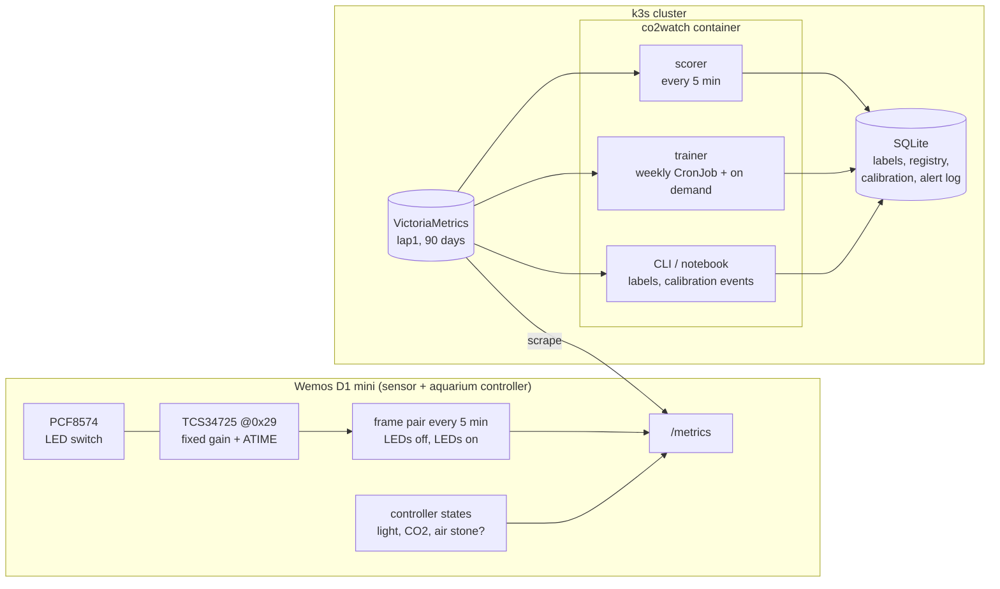

# co2watch design (v0.2)

Self-learning anomaly detection for a CO2 drop checker read by a TCS34725 colour
sensor. This document records the architecture, the decisions made, the options
considered and every assumption. Nothing here has been validated on the real
tank yet. Numbers come from the simulator or from the leaflet.

**v0.2 changes** (decisions from 2026-11-21 to 11-23): no LLM, no Home
Assistant, no notifications for now. Raw data goes to VictoriaMetrics (scraped
from the D1's `/metrics`); SQLite holds only labels, the model registry,
calibration events and the alert log. Each reading is two frames (LEDs off and
on, LEDs switched through a PCF8574).

## 1. Decisions

| Topic | Decision |
|---|---|
| Detection | Classical ML only: hard-fault rules, a per-time-of-day robust baseline, then Isolation Forest. A forecaster is only tried if those miss cases. |
| LLM | Not in the plan. Alerts carry templated reasons written by the detectors. |
| Raw data store | VictoriaMetrics (VM) on the k3s cluster, pinned to lap1, 90-day retention (final, leen 2026-11-26); long-term history is kept as aggregates in SQLite. |
| Other storage | SQLite: labels, model registry, calibration events, alert log, cached daily anchors, and the long-term store (hourly/daily aggregates, raw windows around events). |
| Ingest | The D1 mini serves `/metrics`; VM scrapes it. No Home Assistant, no Influx, no push. The sensor and the aquarium controller share one D1. |
| Notifications | None for now. Alerts are logged; labelling is done with the CLI or the notebook. |
| Illumination | The breakout's two LEDs are switched through a PCF8574 I2C expander. |
| Readings | Two frames per reading, LEDs off then on. Signal = on - off (ambient subtracted); the off frame is the ambient/leak level. |

## 2. Architecture

* The D1 only reads and publishes. All logic runs in Python in a container.
* **Ingest options considered.** *Scrape* (chosen): tiny firmware (a small web
  server, no NTP, no TLS) and VM's own `up{job=...}` gives a free sensor-dropout
  signal; the cost is that readings are lost while VM is down (the D1 holds only
  the latest frame pair). *Push* (rejected): the D1 would POST to VM's
  `/api/v1/import/prometheus`; it could buffer while offline, but needs NTP for
  timestamps, an HTTP client and retry logic on an ESP8266 with little RAM. A
  short ring buffer on the D1 can be added later if scrape gaps turn out to
  matter.
* Plain HTTP on the LAN. Scores and alerts are kept in SQLite; writing a
  `co2_anomaly_score` series back to VM (so scores plot next to the raw data)
  is optional and not implemented.
* Scraping means the ML side can be down without losing data. If the D1 or Wi-Fi
  is down, the gap stays a gap.
* Fully offline.

## 3. Roadmap

This table is the single source for milestones. The earlier local `plan.md`
was merged into this document (2026-11-23) and retired; where they differed,
this repo's version was kept.

| Milestone | Contents | Where | Status |
|---|---|---|---|
| M0 | Design, simulator, self-calibration, VM/CSV access, label store | this repo | done (this PR + #1) |
| M1 | D1 firmware with `/metrics` and two-frame readings via PCF8574; VM scrape job; measure gain and integration time on the real tank. Prerequisite in the k3s repo: VM backup (retention stays at 90 days) | firmware / k3s repos | next |
| M2 | Hard-fault rules + per-time-of-day baseline + daily summaries; templated reasons; alert log; evaluation on simulated data | this repo | done on simulated data (see `docs/detection.md`); evaluation is a CLI command, not a notebook |
| M3 | Isolation Forest on window features, compared against M2 on simulated and labelled events | this repo | |
| M4 | Labelling CLI/notebook flow, weekly retraining, model registry and rollback, active-learning list | this repo | |
| M5 | Container image + Helm chart: namespace, SQLite PVC, toolbox, CronJobs (see `docs/deploy.md`) | this repo | installed on k3s (lap1) 2026-11-25, Helm rev 1, image 0.2.0; calibrate and backup jobs running; score/train jobs switched off until M2-M4 |
| M6 | Evaluate on 2+ weeks of real data, tune thresholds; decide on notifications | this repo | |

## 4. The `/metrics` contract (needed for M1)

The names below are what this code expects. They are set in
`src/co2watch/config.py` and are assumptions until the firmware exists.

| Metric | Labels | Meaning |
|---|---|---|
| `tcs34725_raw` | `channel`=red/green/blue/clear, `led`=off/on | raw counts of the last frame pair |
| `tcs34725_reading_timestamp_seconds` | | when the last frame pair was taken (lets VM's scrape interval differ from the reading interval) |
| `tcs34725_reading_seq` | | increments every reading; a stuck counter means stuck firmware, frozen counts with a moving counter means a stuck sensor |
| `tcs34725_atime`, `tcs34725_gain` | | must stay fixed; a change invalidates the baseline and is flagged |
| `tcs34725_i2c_errors_total` | | I2C failures (dropout rule) |
| `aquarium_light_on`, `aquarium_co2_on`, `aquarium_airstone_on` | | 0/1, only if the controller knows the real states (open item) |
| `aquarium_temperature_celsius`, `aquarium_ph` | | only if those sensors are added (open item) |

Firmware notes from the datasheet: I2C address 0x29 at 3.3 V; saturation at
`(256 - ATIME) * 1024`, capped at 65535 (readings at the limit are masked,
because the subtraction is then wrong); take the off frame and the on frame
back to back so ambient changes little in between; wait one full integration
time after switching the LEDs.

Proposed additions from the datasheet review (not read by the code yet; add to
`config.py` when the firmware exposes them):

| Metric | Meaning |
|---|---|
| `tcs34725_saturated` | any channel at its max count for the current ATIME (masking already exists in `features.py`; this lets the firmware report it directly) |
| `tcs34725_id_ok` | ID register 0x12 read back as 0x44 (a dead bus or wrong chip shows up here) |
| `tcs34725_avalid` | STATUS bit AVALID was set when the frame was read (the reading is a fresh integration) |
| `up{job="..."}` | VM's own scrape-success series, usable as the dropout signal |

Extra hard-fault candidates from these: saturation, ID mismatch, repeated I2C
errors, AVALID never set.

### 4b. Sensor and board facts

From the TAOS TCS3472 datasheet (`aquarium/docs/003341_TCS34725.pdf` in the
aquarium repo; the bare chip, not the breakout board) and from the board in
hand. Nothing here has been measured on the tank.

**TCS34725**

* I2C address 0x29, up to 400 kHz; supply 2.7-3.6 V and the I2C pins follow VDD
  (absolute maximum 3.8 V), so keep the bus at 3.3 V. Operating -30..70 C.
* Integration time = 2.4 ms x (256 - ATIME); max count = (256 - ATIME) x 1024,
  capped at 65535. Examples: 0xFF = 2.4 ms / 1024, 0xF6 = 24 ms / 10240,
  0xC0 = 154 ms / 65535. The saturation limit therefore depends on ATIME.
* Gain 1x / 4x / 16x / 60x (CONTROL 0x0F). Gain and ATIME stay fixed once chosen;
  a change starts a new calibration epoch.
* Four 16-bit channels (R, G, B, clear) integrate simultaneously behind an
  on-chip IR-blocking filter. Clear reads higher than any colour channel and
  saturates first. A small response tail beyond 700 nm remains, so IR from
  sunlight or some lamps leaks a little into every channel.
* Read the eight bytes from 0x14 with the auto-increment command (0xB4), low
  byte first; values are double-buffered. STATUS (0x13) AVALID marks a finished
  integration. After PON there is a 2.4 ms warm-up.
* Dark offset typically 0-5 counts: keep counts mid-range so quantisation does
  not add noise to hue. Responsivity drifts about 250 ppm/C at visible
  wavelengths (read off a log chart, approximate): negligible for tank
  temperatures.
* Responsivity falls off with angle from the optical axis (roughly cosine-shaped),
  the physical basis for the "moved sensor / case slipped" anomalies.
* Not in the datasheet, to be measured on the tank: PWM flicker from the tank
  light, the optics of glass and drop checker, lux formulas. Working assumption
  (untested): an integration time of about 100 ms or more averages typical PWM
  flicker.
* Choosing gain and ATIME (M1): with lights on and the window sunlight bump, the
  clear channel should stay below about 70 % of its max count, while the lowest
  daily counts stay well above the dark offset. Then freeze both and log them.

**Illumination LEDs and the PCF8574**

* The breakout has two white illumination LEDs and an `LED` pin. Polarity and
  the floating default are board-specific and not in the chip datasheet: check
  on the bench before wiring.
* The aquarium plan (`aquarium/PLAN.md`) uses every D1 mini pin (D0 relay 4,
  D1/D2 I2C, D3 button, D4 DS18B20, D5-D7 relays 1-3, D8 PWM, A0 button ladder),
  so the `LED` pin is driven by a **PCF8574 I2C expansion breakout** on the shared
  bus. An Arduino as I/O co-processor was considered and dropped.
* Address: plain PCF8574(T) is 0x20-0x27; the "A" version is 0x38-0x3F, which can
  collide with an SSD1306 OLED at 0x3C/0x3D. Set the jumpers so the address is
  free (TCS34725 is 0x29; a DS3231/DS1307 RTC is 0x68).
* Power it from 3.3 V (never run the bus at 5 V; see the sensor limit above).
* Outputs sink up to about 25 mA but source only a few tens of microamps when
  high (vendor note: loads of 10 uA or more need an external pull-up). The `LED`
  pin is a logic input, so a weak high should do; verify on the real board.
* After power-up all pins are high (to confirm in the PCF8574 datasheet), so the
  LEDs may switch on briefly until the firmware sets the pin. Check that this is
  acceptable, or invert the logic / add a pull resistor to force a safe default.
* The module carries 1 kOhm I2C pull-ups (vendor: markings 102/1001). With the
  RTC, OLED and TCS34725 breakouts also carrying their own, the parallel total
  can drop below the roughly 333 Ohm the vendor warns about; add them up and
  remove the pull-ups from all but one or two boards if needed.
* The firmware must tolerate the expander being absent (count an I2C error, flag
  the frames invalid). A longer I2C cable to the tank-side sensor needs care:
  keep it short, mind the pull-ups, fall back to 100 kHz if unstable.
* LEDs on only during readings also limits heat near the checker and LED ageing;
  LED ageing is itself a slow-drift source to watch.

**Status page instead of Grafana (leen, 2026-11-26).** There is too little to
show for a Grafana stack on lap1. `co2watch serve` (in the toolbox pod)
serves one plain HTML/JS page in the style of the D1's page, read-only, from
SQLite plus a cached VictoriaMetrics read. See `docs/deploy.md`.

**Two pages, two jobs (leen, 2026-11-26).** The D1 page is the quick glance:
CO2 as a percentage, no hue. The co2watch status page is the detailed
"dirty data" view: hue, raw channels, LED-lit and stray light levels, scores,
the learned normal band and the alert reasons with their numbers. Keep the
technical detail on the status page; simplify the D1 page instead.

## 5. Storage

**Retention split (leen, 2026-11-26).** VictoriaMetrics keeps full-resolution
data for 90 days (decided 2026-11-26; 5 years and 6 months were considered and
dropped, 6 months would not fit the 10 GiB volume). What
must outlive that goes to SQLite as **aggregates**, written nightly by
`co2watch archive` (CronJob `co2watch-archive`): hourly and daily summaries of
the D1 series, plus full-resolution raw windows only around logged alerts and
labels (+/- 6 h). Not every raw reading is copied. Size: roughly 1-2 MB per year
for the aggregates, plus about 30 kB per archived event.

**VictoriaMetrics (raw data).** Scraped series have no `source` label. Anything
imported (simulated data, CSV backfill) must carry one (`source="sim"`,
`source="backfill"`), and the code refuses to import without it. Readers select
`source=""` (scraped) by default, so test data can never leak into training.

**SQLite (`src/co2watch/db.py`).**

| Table | What |
|---|---|
| `labels` | normal / real_problem / sensor_issue / ignore / eye_check (with band), time window, feature snapshot |
| `calibration_events` | fluid replaced, sensor moved: starts a fresh baseline |
| `anchors` | daily night low and daytime plateau (derived cache) |
| `alerts` | alert log with score, detector, templated reason |
| `job_runs` | each run of calibrate / score / archive / backup: start, end, ok, one-line summary (shown on the status page; newest 200 per job kept) |
| `models` | every trained model, params, metrics, active flag (rollback = switch the flag) |
| `agg_hourly` | per UTC hour: hue min/p10/median/p90/max, net (LED) signal, stray light median/max, coverage, saturated count, dimmer level, firmware CO2 index, max detection score |
| `agg_daily` | per local day: night low, peak, swing, time the rise reached 50 % / 90 % of the swing, minutes near the peak, stray light max, CO2 index max, alerts, max score, calibration epoch |
| `raw_windows`, `raw_samples` | full-resolution two-frame readings around each alert and label (`co2watch archive`; read back with `archive.read_raw_window`) |

**CSV.** `export-csv` writes VM data (both frames + context, UTC and local time);
`backfill` imports such a CSV into VM under a source label.

## 6. Time handling

* Processed in UTC. A regular 5-minute UTC grid is built when reading; missing
  slots are kept as `missing=True` rows, never interpolated.
* Schedule-related features (hour of day, night, time since CO2 on) use
  Europe/Amsterdam local time. The DST-end day has 25 hours and the DST-start
  day 23; tests cover this.
* "Time since CO2 on" comes from the controller state when it is reported,
  otherwise from the learned daily pattern.

## 7. Features (`features.py`)

* From the two frames: net channels `on - off`, `ambient_clear` (off-frame
  clear), `ambient_frac`, saturation mask.
* Per reading: hue (from the net r, g, b), saturation, r/c, g/c, b/c, local hour.
* Windowed (30 min): rolling median hue, std, slope (deg/hour), net clear
  relative to its 7-day median, ambient level, number of raw value changes
  (0 = flat-line).
* Hue goes **down** as CO2 goes up (blue ~200+, green ~115, lime ~65 degrees on
  the leaflet; the sensor's numbers differ, see section 8).

What the two frames buy (shown on simulated data, to be confirmed on the tank):
tank light and sunlight no longer move the hue; a light leak or a moved sensor
shows up in `ambient_clear` instead of being mixed into the colour; night
readings are valid because the LEDs light the checker.

Not removable by subtraction: PWM flicker of the tank light between the two
frames (simulated as 2 % noise) and the glass optics. Both need measuring on the
tank (M1).

## 8. Self-calibration (`calibration.py`)

Goal: say roughly which leaflet band a reading is in, without a test kit.

**Leaflet (KH4 column)**, hues sampled from the leaflet picture:

| Band | pH | CO2 mg/l | chart hue |
|---|---|---|---|
| blue | 7.6 | 3 | 203 |
| blue-green | 7.2 | 8 | 186 |
| teal-green | 7.0 | 12 | 167 |
| green (target) | 6.8 | 20 | 115 |
| lime (too high) | 6.4 | 50 | 64 |

These match CO2 = 3 x KH x 10^(7 - pH) (checked in tests).

**Model:** `chart_hue = a + b * sensor_hue`, fitted with a Bayesian prior.

* **Night anchor (automatic, daily):** the most stable, bluest 60-minute window
  before the CO2 turns on is assumed to be the 3 mg/l band. This fixes `a`.
  Without controller states, 03:00-08:00 local is used.
* **Scale `b`:** stays at the prior 1.0 +/- 0.35 without other information, so
  estimates far from the night anchor are uncertain. Simulated: a true 21 mg/l
  peak is reported as "about 34 mg/l, plausible 19-61".
* **Eye checks (optional):** `co2watch label eye_check --band green --start ...
  --end ...`. Each one is an anchor with about one band of uncertainty. One
  "green" at the daily peak narrows the simulated estimate to 19-26 mg/l.
* **The daytime plateau is measured, not assumed.** It is the tank's normal
  daily peak and the main reference for the detectors.
* **Calibration events** (`co2watch mark-calibration`): only anchors after the
  event are used; the fit reports `settling` until 3 nights have been seen.
* **Drift report:** robust (Theil-Sen) slopes of night low, plateau and daily
  swing over 14 days. Whole scale moving with a constant swing is consistent
  with fluid ageing and is followed; a shrinking swing points at injection
  (diffuser, bubble counter, regulator) and is flagged in M2.

Chart-based absolute limits ("lime = overdose") are used only when the fit is
`ok` and has eye checks. Until then, overdose is relative to the learned plateau.

## 9. Detection (M2-M3), options considered

| Option | Pros | Cons | Verdict |
|---|---|---|---|
| Hard-fault rules: flat-line (raw frames + `reading_seq`), NaN, saturation, dropout/I2C errors, ATIME/gain changed, net-clear jump (case slipped), ambient jump (leak, moved sensor) | exact, explainable, no data needed | only catches faults | **day one** |
| Per-time-of-day robust baseline: median + MAD of hue per local hour, last 7-14 days, since the last calibration event | small data, explainable ("hue at 16:00 is 4 MADs above normal") | misses slow shape changes | **after 7 days** |
| Daily summaries: plateau, night low, swing, time to plateau vs history | directly catches "never reached green" / "never dropped" | one value per day | **with the baseline** |
| Isolation Forest on window features | cheap, no labels, several features at once | less explainable, needs ~2 weeks | **M3; keep only if it beats M2** |
| Autoencoder / LSTM forecaster | learns shape | needs much more data, harder to explain | only if M2-M3 miss cases |

Combined score: weighted max of normalised component scores with one adjustable
threshold; rules can force an alert. Each alert gets a templated reason from the
detector that fired, e.g. "Hue has not changed for 40 min (raw values frozen):
sensor or I2C problem likely" or "Daily peak 30 % lower than the 14-day normal;
night low normal: check bottle, regulator, diffuser". No free text is generated.

**Labels.** "Normal" windows extend training data immediately.
"Real problem" / "Sensor issue" tune the threshold from the first label
(semi-supervised). A supervised classifier is considered only after **at least
30 positive windows across at least 3 kinds and about 100 normal windows**.
Simulated anomalies may be used for training but are always reported separately.

## 10. Safety

Logging only. No control of CO2, lights or equipment. Any future control must be
opt-in, rate-limited and overridable by hand.

## 11. Assumptions (please correct)

1. One frame pair every 5 minutes; gain and ATIME never change. Hue is computed
   here, not on the D1.
2. With the LEDs on, the checker is lit well enough at night; the off frame is a
   fair estimate of the ambient light during the on frame.
3. Overnight the checker gets close to the leaflet's lowest band (3 mg/l). If
   night CO2 stays higher, all CO2 estimates shift; relative detection is
   unaffected.
4. The metric names in section 4.
5. The simulator schedule (CO2 11:00-18:00, lights 13:00-20:00, water change
   11:00, sun around 15:30) is a placeholder.

## 12. Open items

From the local sessions (2026-11-21 to 11-23), kept here so they don't get lost.
Nothing in this repo applies anything to the cluster.

1. VM retention: **stays at 90 days** (leen, 2026-11-26). 5 years and 6 months
   were considered; 6 months would need 8-12 GB on the 10 GiB volume (334 MB
   after ~6 days). Long-term history comes from the SQLite aggregates
   (section 5). The unapplied 5y edit in the k3s repo can be reverted. Still
   true: the cluster runs the VM image as `:latest` (pin to v1.156.0 only in that
   local edit), and VM data only goes back to 2026-11-21.
2. VM backup: Longhorn snapshot/backup, or `vmbackup` to the pi1 backup volume.
3. DNS: `monitoring.fritz.box` did not resolve from the workstation on 11-21.
   Not investigated.
4. PCF8574 module: check address and jumpers, power-up state of the outputs and
   the combined I2C pull-ups (details in section 4b).
5. Aquarium docs: add the expander and the TCS34725 header to
   `aquarium/PLAN.md` and the wiring docs.
6. Still unanswered:
   * Does the controller report the real light and air stone states?
   * Will temperature and pH sensors be added?
   * Where does the ML container run (which node)?
7. Next milestone: M1 (firmware `/metrics`, VM scrape job, measure gain and
   integration time on the tank).
8. **"Fluid refreshed" button (backlog, not built yet, leen 2026-11-26).** A
   button on the D1 page that logs a calibration event (`kind=fluid_change`, the
   same as `co2watch mark-calibration`), so the anomaly model starts a fresh
   baseline after a drop-checker refill instead of flagging the colour jump.
   Context: the checker can't be taken off its suction cup, so every refill
   also shifts its position and colour a little. Planned routine: refill,
   re-place the sensor roughly, wait about a day for a full CO2 cycle, then
   re-set the CO2 index Low/High ends. Open questions for when it's built: how
   the D1 hands the event to the SQLite/ML side (e.g. a `co2watch_calibration_event`
   counter in `/metrics` that a CronJob turns into a row), and whether it should
   also reset the Low/High ends to "learning" automatically.
9. **Current data is throwaway (leen 2026-11-26).** The readings collected so
   far come from a temporary hardware setup and are not used for training,
   baselines or evaluation. A new data set starts once the setup is permanent
   (sensor on a protoboard, fixed sensor position): log a calibration event at
   that moment, freeze gain and ATIME, and run the 1-2 week cold start from
   there. Until then, test the detectors on simulated data only.
