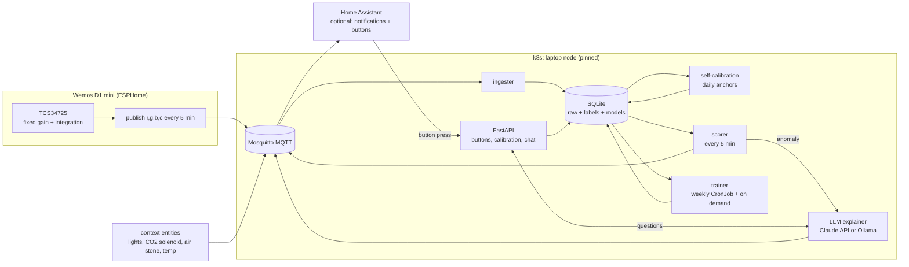

# co2watch design (v0.1, step 1)

Self-learning anomaly detection for a CO2 drop checker read by a TCS34725 colour
sensor. This document records the architecture, the options considered and every
assumption. Nothing here has been validated on the real tank yet. Numbers come
from the simulator or from the leaflet.

## 1. Architecture

* The ESP only reads and publishes. All logic runs in Python on the laptop.
* MQTT decouples everything: the ESP keeps publishing if the ML stack is down,
  and the ingester replays nothing it missed (the ESP has no buffer). Gaps are
  stored as gaps.
* Everything works offline apart from the optional LLM call.

## 2. Build steps

| Step | Contents | Status |
|---|---|---|
| 1 | Design, data model, features, simulator, self-calibration | this PR |
| 2 | Laptop stack: Mosquitto, ingester, k8s manifests, HA/ESPHome config | next |
| 3 | Detection: rules + per-hour baseline, then Isolation Forest; evaluation notebook | |
| 4 | Feedback loop, retraining, model registry, LLM explanations and chat | |

## 3. Data model (SQLite, `src/co2watch/db.py`)

| Table | What | Notes |
|---|---|---|
| `readings` | raw r, g, b, clear per reading | append-only, UTC epoch ms, never edited |
| `context` | state *changes* of lights, CO2, air stone, temp, pH | forward-filled onto the grid when read |
| `labels` | your button presses with time window + feature snapshot | `eye_check` labels carry a colour band |
| `calibration_events` | fluid replaced, sensor moved | starts a fresh baseline |
| `anchors` | daily night low and daytime plateau | derived, can be recomputed |
| `anomaly_events` | fired alerts with score, details, explanation | step 3 |
| `models` | every trained model, metrics, active flag | rollback = switch the active flag |

**Why SQLite over InfluxDB:** about 105k rows a year, one writer, needs to hold
labels and model metadata as well as time series, and is a single file to back
up. InfluxDB would add a service without solving a problem we have. Grafana can
still read SQLite through a plugin if you want dashboards.

## 4. Time handling

* Stored and processed in UTC. A regular 5-minute UTC grid is built when reading;
  missing slots are kept as `missing=True` rows, never interpolated.
* Anything schedule-related (hour of day, "night", "since CO2 on") is computed in
  Europe/Amsterdam local time. The DST-end day has 25 hours of slots and the
  DST-start day 23; tests cover this.
* Preferably "time since CO2 on" comes from the solenoid entity, not the clock,
  so a schedule change does not look like an anomaly.

## 5. Features (`features.py`)

* Per reading: hue (HSV, from raw r, g, b), saturation, r/c, g/c, b/c, clear,
  local hour, UTC offset.
* Windowed (30 min): rolling median hue, hue std, hue slope (deg/hour), clear
  relative to its 7-day median, number of raw value changes (0 = flat-line).
* Hue goes **down** as CO2 goes up: blue ~ 200+, green ~ 115, lime ~ 65 degrees on
  the leaflet. The sensor's own numbers differ (see section 6).

## 6. Self-calibration (`calibration.py`)

The goal is to say roughly "which band of the leaflet is this?", without a pH or
KH test kit.

**Leaflet (KH4 column)**, hues sampled from the leaflet picture:

| Band | pH | CO2 mg/l | chart hue |
|---|---|---|---|
| blue | 7.6 | 3 | 203 |
| blue-green | 7.2 | 8 | 186 |
| teal-green | 7.0 | 12 | 167 |
| green (target) | 6.8 | 20 | 115 |
| lime (too high) | 6.4 | 50 | 64 |

These match the standard formula CO2 = 3 x KH x 10^(7 - pH) (checked in tests).

**Model:** `chart_hue = a + b * sensor_hue`, a straight line fitted with a
Bayesian prior.

* **Night anchor, automatic, daily.** After a night of air stone, the most stable,
  bluest 60-minute window before the CO2 turns on is assumed to be the 3 mg/l
  band. This fixes `a`. If the solenoid or air stone states are not available,
  03:00-08:00 local time is used.
* **Scale `b`.** Without other information it stays at the prior 1.0 +/- 0.35
  (the leaflet's own spacing). This makes estimates far from the night anchor
  uncertain. The simulator shows this honestly: a true 21 mg/l daily peak is
  reported as "about 34 mg/l, plausible 19-61".
* **Eye checks, optional.** A notification occasionally asks "what colour does
  the checker look by eye?" (blue / blue-green / green / lime). Each answer is an
  anchor with about one band of uncertainty. Two at different colours fix `b`; in
  the simulator one "green" at the daily peak narrows the estimate to 19-26 mg/l.
* **The daytime plateau is measured, not assumed.** It is your tank's normal
  daily peak and the main thing the detectors compare against. It is never
  forced to "green".
* **Calibration events** (button): only anchors after the event are used, and
  the fit reports `settling` until 3 nights have been seen.
* **Drift report:** robust (Theil-Sen) slopes of night low, plateau and the
  daily swing over 14 days.
  * whole scale moving, swing constant: consistent with fluid ageing; followed,
    not flagged.
  * swing shrinking (plateau creeping toward the night level): injection
    problem (diffuser, bubble counter, regulator); flagged in step 3.

**Rule:** chart-based absolute limits (e.g. "lime = overdose") are only used when
the fit is `ok` *and* has eye checks. Until then, overdose is detected relative to
your own learned plateau.

## 7. Detection plan (steps 3-4), options considered

| Option | Pros | Cons | Verdict |
|---|---|---|---|
| Hard-fault rules (flat-line, NaN, out of range, dropout, clear-level jump) | exact, explainable, no data needed | only catches faults | **day one** |
| Per-time-of-day robust baseline (median + MAD of hue per local hour, last 7-14 days, since last calibration event) | small data, explainable ("hue at 16:00 is 4 MADs above normal") | misses shape changes slower than the window | **day one after 7 days** |
| Daily-summary checks (plateau, night low, swing, time-to-green vs history) | catches "never reached green" / "never dropped" directly | one value per day, slow | **with baseline** |
| Isolation Forest on window features | cheap, no labels, handles several features | scores harder to explain; needs ~2 weeks | **add after baseline, keep if it beats it on simulated + labelled events** |
| Autoencoder / LSTM forecaster | learns shape, good on long series | needs much more data, harder to explain, PyTorch on the cluster | not now; revisit after ~3 months of data |

The combined score is a weighted max of the normalised component scores with one
adjustable threshold; rules can force an alert regardless.

**Labels.** "Normal" windows extend the training data immediately. "Real
problem" / "Sensor issue" tune the threshold from the first label (semi-supervised).
A supervised classifier (e.g. gradient boosting on window features) is only
considered after **at least 30 positive windows across at least 3 kinds and
about 100 normal windows**. Simulated anomalies may be used for training but are
always reported separately from real ones.

## 8. LLM layer (step 4)

* Explanation only, never detection. It receives a computed summary (today's
  plateau vs normal, night low, slopes, which rules fired, context states,
  calibration status) and must cite those numbers, hedge, and say "no data" when
  something is missing.
* Chat questions ("why was yesterday different?") are answered by having the
  model call a few fixed, read-only query functions over SQLite. It does not get
  free-form SQL access.
* Options: Claude API (best quality, cost is cents per month at a few calls a
  day, needs internet) or Ollama with a small local model on the laptop (offline;
  quality depends on RAM/GPU). Both behind one interface; choice is open.

## 9. Safety

Notifications only. No control of CO2, lights or equipment. Any future control
must be opt-in, rate-limited and overridable by hand.

## 10. Assumptions (please correct)

1. Readings arrive every 5 minutes as raw r, g, b, clear; gain and integration
   time never change. Hue is computed here, not on the ESP.
2. The sensor board's own LED lights the drop checker, so readings at night are
   valid. *If the LED is off and the sensor relies on tank light, night anchors
   don't work and the calibration needs a different design.*
3. Overnight the drop checker gets close to the leaflet's lowest band (3 mg/l).
   If your night CO2 stays higher, all CO2 estimates shift; relative detection
   is unaffected.
4. Context (lights, CO2 solenoid, air stone) will be available as entities. The
   system still works without them, with lower confidence.
5. The schedule used by the simulator (CO2 11:00-18:00, lights 13:00-20:00, water
   change 11:00, sun around 15:30) is a placeholder.

## 11. Open questions

* Is Home Assistant running, or should notifications come from this stack
  (e.g. ntfy) directly?
* Laptop RAM/GPU and whether it stays on 24/7 (decides local LLM vs Claude API).
* Does the sensor board have its LED on during readings?
