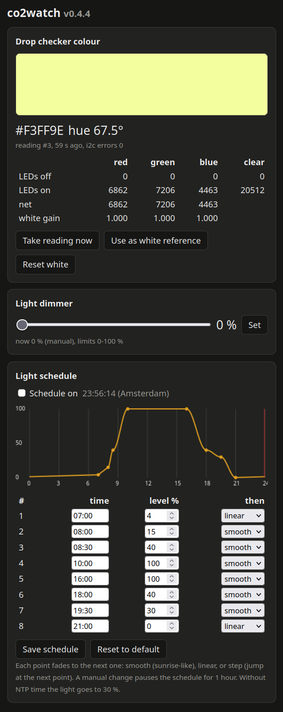
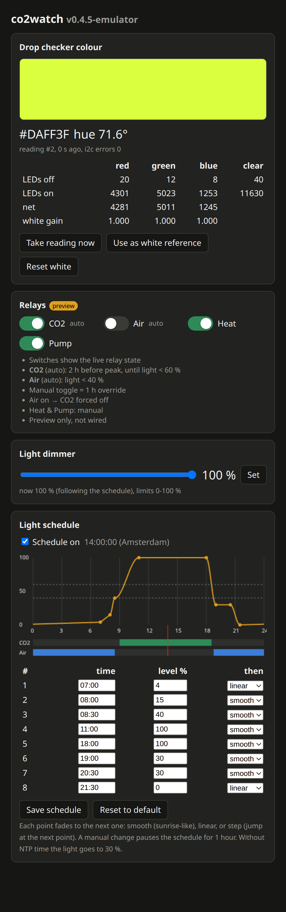
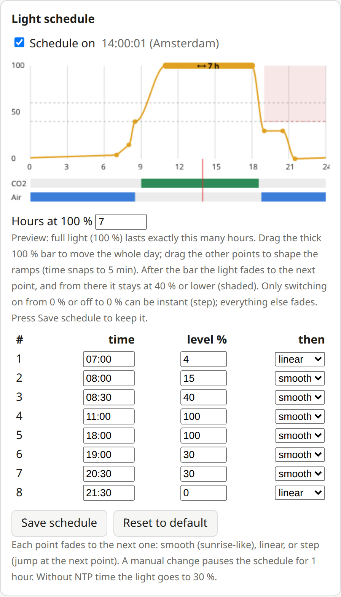

# Firmware

`co2watch/` is the Arduino sketch for the Wemos D1 mini (ESP8266) that reads the
drop checker and drives the light dimmer.



## What it does

- Reads the TCS34725 every 5 minutes as two frames, LEDs off then on. The LEDs
  are switched through PCF8574 P0, which is found by an I2C scan. Gain (4x) and
  ATIME (0xC0, 154 ms) are fixed constants.
- Serves `/metrics` (Prometheus text, scraped by VictoriaMetrics job `co2watch`)
  with the names from `docs/design.md` section 4, plus `tcs34725_hue_degrees`,
  `aquarium_light_dim_*` and `co2watch_build_info`.
- Serves a web page on `/`: drop-checker colour (net = on - off, white
  balanced, as swatch, hex and hue), raw counts, and a dimmer slider.
  White balance is display-only; `/metrics` keeps the raw counts.
- Dimmer: D6 (GPIO12), 1 kHz PWM into a PWM-to-0-10V board, then the LCM-40
  DIM input. Manual only (`/dimmer?level=NN`, the page, or serial `dNN`),
  clamped to `DIM_MIN_PCT`..`DIM_MAX_PCT` (compile-time). The last level is
  stored in flash and restored at boot. During a reset D6 is low, so the light
  drops to its minimum for about a second.

- Light schedule (always on after a boot; switching it off on the page lasts until
  the next reboot; default: 4 % at 07:00, 18 % at 09:00, 40 % at 09:50, 100 % from 11:00 to 18:00,
  40 % at 18:30, 25 % at 19:55, off by 21:30): 8 points (24-hour HH:MM +
  level), each fading to the next one (smooth cosine, linear or step), wrapping
  at midnight. Time from `nl.pool.ntp.org` in Europe/Amsterdam (DST handled).
  A manual change pauses the schedule for 1 hour; without a valid time the
  light goes to 30 %. Stored in flash; API at `/api/schedule`.

- CO2 index (v0.6.0): zooms into the drop checker's colour band. The hue
  (average of the last 3 readings) is mapped so a "low" hue = 0 % and a "high"
  hue = 100 % (`co2watch_co2_index_percent`, not clamped). Default ends are
  203 deg (leaflet 3 mg/l) and 153.5 deg (set on the D1 on 2026-11-26), not yet
  calibrated over a full day: set the ends on the page ("Set low = now" when the checker is fully
  blue). Ends stored in flash; API `/api/co2index?low=&high=` (deg or `now`).
  Raw counts are unchanged.

Wiring: SDA D2, SCL D1, TCS34725 at 0x29, PCF8574 at 0x20 (on the bench board).

## Secrets

Create `co2watch/secrets.h` (gitignored):

```c
#define WIFI_SSID "..."
#define WIFI_PASS "..."
#define OTA_PASS  "..."   // enables over-the-air updates
```

Without it the sketch runs serial-only.

## Build and flash

Board `esp8266:esp8266:d1_mini` (ESP8266 core 3.1.x); no extra libraries.

- USB: `arduino-cli compile --upload -b esp8266:esp8266:d1_mini -p /dev/ttyUSB0 firmware/co2watch`
  (your user needs to be in the `dialout` group).
- Over WiFi: `firmware/flash-ota.sh [host]` (default `co2watch.fritz.box`).
  Set `ARDUINO_CLI` if `arduino-cli` is not on `PATH`.

### Relay preview (emulator only)

The emulator also shows a **preview** of a relay section (CO2, Air, Heat, Pump)
with switch-style sliders that both control and show each relay. While the
schedule is on, CO2 and Air follow rules derived from the light schedule: CO2
from 2 h before the light peaks until it drops below 60 %, Air whenever the light
is below 40 %. Air always wins: CO2 is never on while Air is on. A manual switch
holds for 1 hour. Heat and Pump are manual. The schedule graph shows the CO2 and
Air on-times as bands. **The firmware has no relay code yet**; on the D1 this
section stays hidden because the board reports no relays.



### Schedule drag editing

In the emulator the schedule graph is editable by dragging. The 100 % stretch is
a bar of exactly "Hours at 100 %" hours (default 7): drag it to move the whole
day, change the field to resize it. Other points drag one by one (5 min snap);
before the bar they stay below 100 %, and from the first point after it the
light stays at 40 % or lower. The fade straight after the bar may pass
above 40 %. Only switching on from 0 % or off to 0 % may be a step; everything
else fades. Nothing is stored until Save schedule. Since v0.5.0 the D1 serves this
too (`drag:true` in `/api/state`) and stores the hours value with the schedule
(`/api/schedule?maxh=`). The limits are enforced by the page while editing.



## Editing the web page

The page is `co2watch/page.html`. `gen_page.py` turns it into `co2watch/page.h`
(the PROGMEM string the firmware serves); `flash-ota.sh` runs it for you.
Commit both files so the Arduino IDE can build without the script.

Try page changes locally without flashing:

```bash
python3 firmware/emulator/emulate.py            # http://localhost:8080/
python3 firmware/emulator/emulate.py --start 06:45 --speed 60   # watch a sunrise
python3 firmware/emulator/emulate.py --no-ntp   # board without time (safe 30 %)
python3 firmware/emulator/emulate.py --errors   # every 3rd POST fails
python3 firmware/emulator/emulate.py --host 0.0.0.0   # open it from your phone
```

It serves `page.html` fresh on every request (just reload) and mocks the
firmware API (`/api/state`, `/api/schedule`, `/dimmer`, `/white`, `/read`,
`/metrics`) with in-memory state and simulated drop-checker readings. The
schedule logic mirrors the firmware; keep the two in sync when changing it.

Bump `FW_VERSION` with each change; it shows on the page and in `/metrics`.
